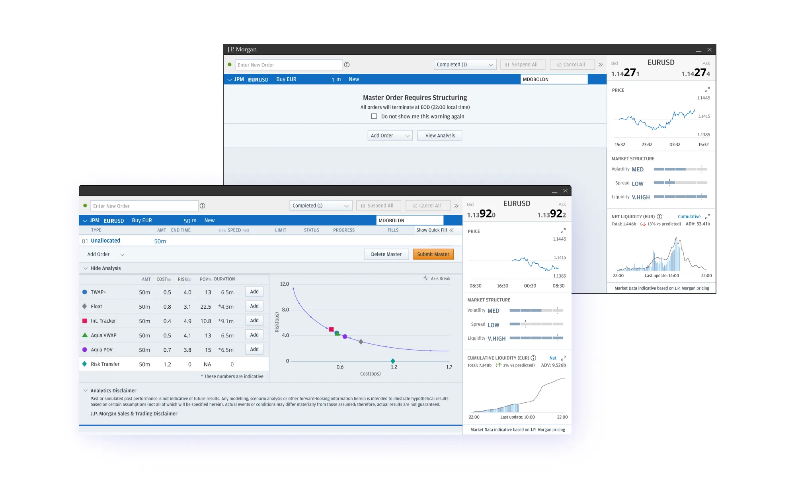

## Project Summary

Algo trading desk operators were monitoring live strategies across disconnected screens with no single status view. When an algorithm drifted from expected behaviour, diagnosis and intervention were slow, in markets where milliseconds matter.

## My Role

As **UI Designer**, I translated algorithmic trading workflows into precise, scannable interfaces. I owned interaction design, detailed Figma specifications, and visual QA through release, working closely with product and engineering.

## Design Process

I designed a **real-time monitoring cockpit**: one screen for all running strategies, anomaly highlights, and intervention controls.

A **traffic-light status system** gave operators a quick read on portfolio health, then a clear path into the strategies needing attention. Critical actions stayed within two clicks.

