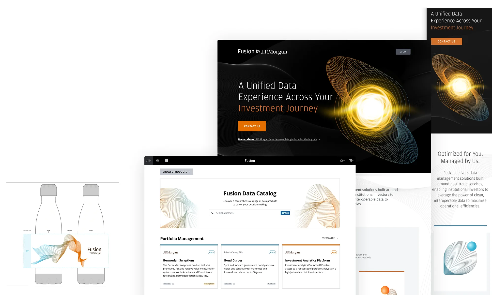

## Project Overview

**The problem.** Product teams were rebuilding the same components, creating visual drift, duplicated effort, and slower delivery. There was no shared source of truth for design or code.

**The goal.** Build a **scalable design system** for enterprise products, from analytics dashboards to data management tools. It had to support data-dense interfaces without becoming a bottleneck.

## My Role

As **Product Designer** on the core design team, I owned visual identity, component architecture, and accessibility standards. I built the Figma pattern library on the Salt Design System foundation, translating complex data requirements into reusable interaction patterns.

## Design Process

**Requirements.** I worked with the product owner, UX, development, and an ADA specialist to define the system goals and review patterns against real product needs.

**Component architecture.** I built the system with **design tokens, auto layout, and variants** in Figma. The library covered headers, navigation, data grids, progress tracking, drawers, forms, date selectors, tabs, cards, and data visualisation patterns.

**Accessibility.** Components were validated against **WCAG 2.1 AA** using Colour Contrast Analyser and axe DevTools.

**Developer handoff.** I partnered with developers through the build, delivering dev-ready specs and documentation.

## Decisions

### Decision 1. Extend Salt, not greenfield.

*Options considered:* extend Salt (JPM’s internal foundation), fork Salt and diverge, build a parallel custom foundation.

*What I chose:* build Fusion as an extension of Salt, inheriting tokens and primitives while layering Fusion-specific enterprise data patterns on top.

*Why:* Salt already had governance, accessibility tooling, and developer adoption inside J.P. Morgan. Extending it let Fusion focus on domain-specific data patterns, not re-solving button states.

### Decision 2. Both atoms and compounds, governed.

*Options considered:* atomic only (small, composable), compound only (large opinionated blocks), both layers.

*What I chose:* both tiers with clear naming conventions separating them.

*Why:* A pure atomic system asks every product to compose its own complex surfaces, which inevitably drifts. A pure compound library is rigid and unloved. Both tiers, with clear naming conventions, let the system govern the shared surfaces while staying out of the way on novel ones.

### Decision 3. Figma-first spec, code as implementation truth.

*Options considered:* Figma-first with code as output, code-first with Figma mirrored, dual source with tooling to sync.

*What I chose:* Figma-first for visual and interaction spec; code repo as the source of truth for implementation; a spec column in each component page showing both.

*Why:* Figma is where design review happens, so Figma-first kept design and review in one tool. Code is where runtime behaviour actually lives, so code-as-source for implementation avoided designer-engineer drift. Publishing both in the same component page meant a designer or engineer could start on either side and find the answer they needed.

## Accessibility in practice

WCAG 2.1 AA compliance is a claim that hiring managers rightly push on. Three checks ran against every component before it merged into the library.

1. **Automated**

   Colour contrast analysed against 4.5:1 and 3:1 thresholds with Colour Contrast Analyser. DOM structure validated with axe DevTools for landmarks, headings, ARIA roles, and focus-trap integrity.

2. **Keyboard only**

   Every interactive surface tested end-to-end without a mouse. Documented tab order, 2px focus outline token, reversible Escape and Cancel paths. Modal dialogs trap focus on open and return it to the trigger on close.

3. **Screen reader**

   Components with non-trivial state (Progress Tracker, Data Grid sort and filter, Year/Week Picker) reviewed with VoiceOver and NVDA. Announcements written for clarity: "Column 3, sorted ascending, 47 results" instead of raw ARIA attributes.

Each check produced a per-component record. Happy to walk through the evidence on a call.
