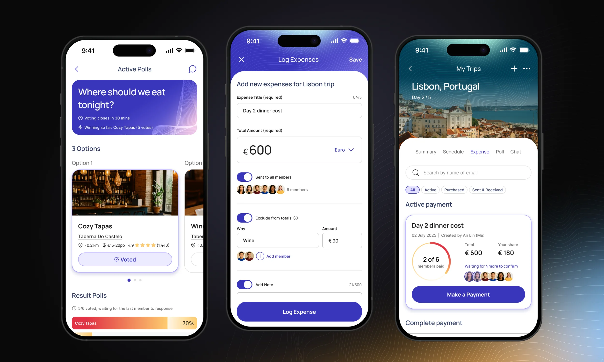

## Project Overview

**The brief.** Improve TripUp for **group decision-making and expense tracking** during trips: quick polls, live vote feedback, itinerary updates, and easier settlement.

**The core problem.** Group travel coordination is scattered across chat, expense apps, and separate itineraries. Users need one surface for decisions, payments, and plans.

## My Role

I owned the design process from **user research and competitor analysis** through to wireflows, journey mapping, visual direction, and high-fidelity mobile UI. Deliverables included personas, a complete wireflow, colour and type, and polished iPhone 16 screens.

## Design Process

**User research.** I created two personas: the Organiser, who manages logistics, and the Participant, who wants to vote, pay, and stay updated with minimal effort. Key insight: trip decisions happen mid-flow, so the interface needed a **two-tap rule**.

**Competitor analysis.** I audited Splitwise, Tricount, and Settle Up. They handle expense splitting well, but lack travel-specific features like polls, itinerary sync, and live group coordination.

**User journey mapping.** I mapped the flow from adding a friend through dinner polling, group voting, itinerary sync, expense logging, and settlement.

**UI solution.** The final screens focused on three interactions: **Poll Creation**, **Live Voting View**, and **Expense Split**. Smart defaults kept the experience lightweight.

